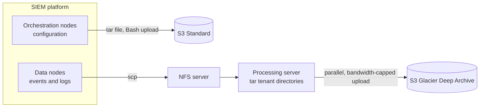

# Hrithik Sawant

### DevOps / Site Reliability Engineer

Mumbai, India · open to remote

 

I build and operate the infrastructure that keeps data pipelines reliable: Kafka log pipelines, terabyte-scale backups on AWS, and the automation around them. At [One2N](https://one2n.io) (2022 – 2024) I did this for a multi-tenant security platform.

> [!TIP]
> **Open to DevOps, SRE and Platform Engineering roles.** The quickest way to reach me is [LinkedIn](https://in.linkedin.com/in/hrithik-sawant-740a46183).

## At a glance

| 1.5 TB | 100+ | under $200 | since Jan 2023 |
|:---:|:---:|:---:|:---:|
| of SIEM data backed up per day | tenants with automated backup and restore | monthly running cost on AWS | running in production |

## Featured work

### Backup and recovery for SIEM data at terabyte scale

A managed security provider needed a cheaper, customisable and fully automated backup process for its SIEM platform. I designed and built it on my own in about four months. [Read the One2N case study](https://one2n.io/case-studies/backup-and-recovery-solution-for-siem-data-at-terabyte-scale).

<b>Design decisions</b>

 

- **Protect production first.** Packaging and upload originally ran on the data nodes and drove up CPU and disk IO, so I moved that work to an NFS server and a separate processing server.
- **Cap the network impact.** Uploads use the AWS CLI bandwidth limit over a dedicated network path, so 1.5 TB a day doesn't compete with live traffic.
- **Use the link fully.** Uploads run in 10 parallel sessions instead of one file at a time, and the pipeline stages overlap.
- **Keep disks from filling.** The pipeline checks free space during copy and archive steps, and cleans up after each upload.
- **Keep storage cheap.** Event data goes to Glacier Deep Archive and configuration to S3 Standard, with lifecycle rules for retention, default bucket retention and versioning.
- **Make restore routine.** A restore script runs the same path in reverse and puts data back into each tenant's own directory structure.

### More work

| Project | What it is | Stack |
|:--|:--|:--|
| **Log-ingestion middleware** | A layer that decouples log producers from consumers, improving throughput and reliability of security log pipelines | Spring Boot, Apache Kafka |
| **[Routing sensitive logs to Syslog](https://one2n.io/blog/routing-sensitive-logs)** | A blog post I wrote on separating sensitive logs from the main stream with Log4j2 appenders and central configuration instead of code changes | Java, Log4j2, Syslog |
| **[aws-examples](https://github.com/HrithikSawant/aws-examples)** | Public, hands-on AWS exercises: S3, VPC, IAM least-privilege policies, EC2, STS, Route 53 and gateways | AWS, AWS CLI |

## Experience

| | |
|:--|:--|
| **2022 – 2024** | **Software Engineer, [One2N](https://one2n.io)** (remote). Built the Kafka log pipeline and the SIEM backup and recovery system, automated tenant-aware restores, and helped run a 100+ tenant environment. |
| **2022** | **Software Engineer Intern, One2N.** Spring Boot application with role-based access control and JWT-secured APIs, built test-first. |

## Toolbox

<b>What I work with</b>

 

| Area | Tools |
|:--|:--|
| Cloud | AWS (EC2, S3, VPC, IAM, Route 53, API Gateway, STS), Linux |
| Containers | Docker, Docker Compose, Kubernetes |
| Infrastructure as code | Terraform, Crossplane, Ansible |
| Observability | Prometheus, Grafana, Loki |
| CI/CD | GitHub Actions, Bash |
| Languages | Go, Python, Java |
| Data and backend | Kafka, Spring Boot, PostgreSQL, FastAPI |

## Next

Building out my home lab (Kubernetes, Prometheus, Grafana, Loki, Crossplane, Terraform) and publishing the code and write-ups.

 

[Portfolio and blog](https://hrithiksawant.github.io) · [LinkedIn](https://in.linkedin.com/in/hrithik-sawant-740a46183) · [iximiuz Labs](https://labs.iximiuz.com/u/hrithiksawant)

