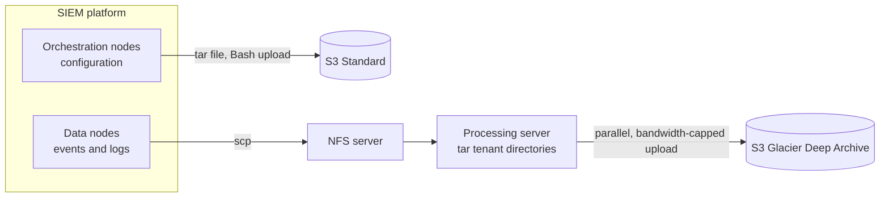

# Hrithik Sawant

### DevOps / Site Reliability Engineer

Mumbai, India · open to remote

 

I build and operate the infrastructure that keeps data pipelines reliable, from terabyte-scale backups on AWS to the automation that runs them, for a multi-tenant security platform. Comfortable picking up any CNCF project.

> [!TIP]
> **Open to DevOps, SRE and Platform Engineering roles.** The quickest way to reach me is [LinkedIn](https://in.linkedin.com/in/hrithik-sawant-740a46183).

## At a glance

| 1.5 TB | 100+ | under $200 | since Jan 2023 |
|:---:|:---:|:---:|:---:|
| of SIEM data backed up per day | tenants with automated backup and restore | monthly running cost on AWS | running in production |

## Featured work

### Backup and recovery for SIEM data at terabyte scale

A managed security provider needed a cheaper, customisable and fully automated backup process for its SIEM platform. I designed and built it on my own in about four months. [Read the One2N case study](https://one2n.io/case-studies/backup-and-recovery-solution-for-siem-data-at-terabyte-scale).

### More work

| Project | What it is | Stack |
|:--|:--|:--|
| **Log-ingestion middleware** | A layer that decouples log producers from consumers, improving throughput and reliability of security log pipelines | Spring Boot, Apache Kafka |
| **[Log-Routing-App](https://github.com/HrithikSawant/Log-Routing-App)** | A service that sends selected logs to a Syslog server and the rest to the console, set up through Log4j2 and run with Docker. The code behind my blog post, [Routing sensitive logs to Syslog](https://one2n.io/blog/routing-sensitive-logs) | Java, Spring Boot, Log4j2, Docker |
| **[customer-data-pipeline](https://github.com/HrithikSawant/customer-data-pipeline)** | A containerised ETL pipeline: a Flask mock source, a FastAPI ingestion service that upserts paginated records, and PostgreSQL, all run with Docker Compose | Python, FastAPI, PostgreSQL, Docker Compose |
| **Voting app on Kubernetes** | A Helm chart that deploys a microservices voting app: vote and result UIs and APIs, a worker, Redis and PostgreSQL, or NATS as a lighter backend. Includes optional ingress with TLS through cert-manager, secrets from external stores, hardened pods and per-environment Helmfile releases | Kubernetes, Helm, Helmfile, Redis, PostgreSQL, NATS |
| **[aws-examples](https://github.com/HrithikSawant/aws-examples)** | Public, hands-on AWS exercises: S3, VPC, IAM least-privilege policies, EC2, STS, Route 53 and gateways | AWS, AWS CLI |

## Experience

| | |
|:--|:--|
| **2022 – 2024** | **Software Engineer, [One2N](https://one2n.io)** (remote). Built the Kafka log pipeline and the SIEM backup and recovery system, automated tenant-aware restores, and helped run a 100+ tenant environment. |
| **2022** | **Software Engineer Intern, One2N.** Spring Boot application with role-based access control and JWT-secured APIs, built test-first. |

 

[Portfolio and blog](https://hrithiksawant.github.io) · [LinkedIn](https://in.linkedin.com/in/hrithik-sawant-740a46183) · [iximiuz Labs](https://labs.iximiuz.com/u/hrithiksawant)

